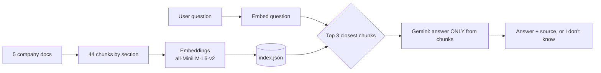

# Flowly Help Bot: a RAG chatbot

A chatbot that answers employee and customer questions about **Flowly**, a fictional Israeli SaaS company, using only its internal documents (employee handbook, onboarding guide, product FAQ, support policy, security policy). Each answer cites its source, and the bot says "I don't know" when the answer isn't in the docs.

Built as a hands-on learning project in Retrieval-Augmented Generation (RAG).

## How it works



1. **Chunking:** each Markdown doc is split by section (about 150 to 250 words, small overlap).
2. **Embeddings:** every chunk becomes 384 numbers that capture its meaning (`all-MiniLM-L6-v2`). Done once and saved in `index.json`.
3. **Retrieval:** the question is embedded the same way, and cosine similarity finds the 3 closest chunks.
4. **Generation:** Gemini (`gemini-3.8-flash`) gets the chunks plus strict rules: answer only from them, cite the file, or say "I don't know".

## Results

Tested on 15 questions with known answers, using a small local model (Qwen2.5-1.5B) before switching to Gemini: **13/15 correct**, including both questions whose answers are not in the docs. Both misses came from retrieval picking the wrong chunks, not from the model inventing facts.

## Tech choices

- **fastembed (ONNX)** instead of PyTorch for embeddings: same model and identical vectors, but light enough for Streamlit Community Cloud's ~1 GB RAM.
- **Gemini free tier** for generation: no GPU needed.
- **No vector database:** 44 chunks fit in a NumPy array; a database would be needed at scale.

## Run locally

```bash
pip install -r requirements.txt
export GEMINI_API_KEY="your-key"   # free at https://aistudio.google.com/apikey
streamlit run streamlit_app.py
```

## Deploy (Streamlit Community Cloud)

1. Push this folder to a public GitHub repo.
2. At https://share.streamlit.io create an app pointing to `streamlit_app.py`.
3. In the app's **Settings > Secrets**, add: `GEMINI_API_KEY = "your-key"`.

## Files

| File | Purpose |
|---|---|
| `streamlit_app.py` | Chat UI |
| `rag.py` | Retrieval + prompt + Gemini call |
| `index.json` | Precomputed chunks and embeddings |
| `requirements.txt` | Dependencies |
